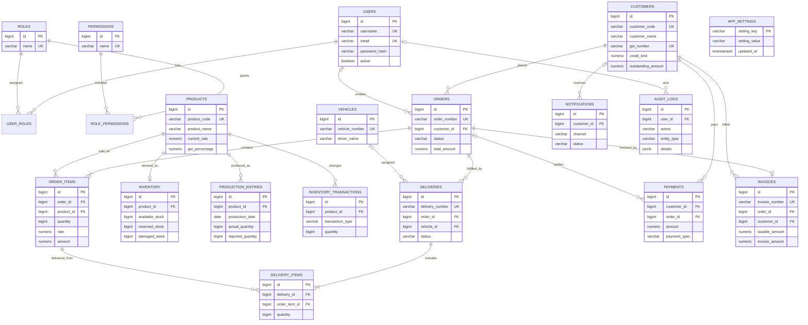

# Database ER Diagram

The V1 Flyway migration creates the schema shown below. This is the initial relational foundation; table coverage does not imply that business workflows or APIs are implemented.

JPA access must remain through JPQL and Spring Data derived queries. Native SQL is not to be added to repository methods. Flyway SQL is used only for schema evolution and indexes/constraints.
